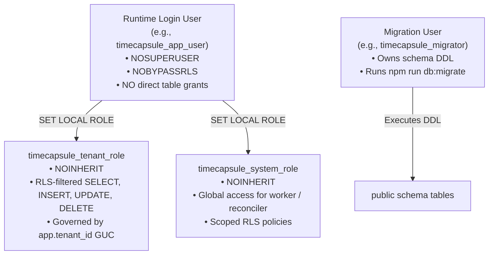

# PostgreSQL Role Layout & Runtime Security Architecture (Task A5)

## 1. Required Role Hierarchy

In production environments, database connections MUST strictly adhere to a least-privilege three-tier role separation:



### Role Specifications:
1. **Migration User (`timecapsule_migrator`)**:
   - Executes migrations `001` through `010`.
   - Creates roles, tables, indexes, and RLS policies.
   - Distinct from runtime user.
   - *Note on Migration 007 & 010*: The migrations execute `GRANT timecapsule_system_role, timecapsule_tenant_role TO CURRENT_USER`. If migrations run as a dedicated migrator user, an explicit post-migration grant must be executed for the application login role:
     ```sql
     GRANT timecapsule_tenant_role, timecapsule_system_role TO timecapsule_app_user;
     ```

2. **Application Runtime Login User (`timecapsule_app_user`)**:
   - `NOSUPERUSER`
   - `NOBYPASSRLS`
   - `NOCREATEDB`, `NOCREATEROLE`
   - **Zero direct table grants**: Has no direct `SELECT`, `INSERT`, `UPDATE`, or `DELETE` on public tables. It only has `USAGE` on schema `public` and membership in `timecapsule_tenant_role` and `timecapsule_system_role`.
   - Transitions to tenant context via `SET LOCAL ROLE timecapsule_tenant_role` and `SELECT set_config('app.tenant_id', $1, true)`.
   - Transitions to system context (worker/reconciler only) via `SET LOCAL ROLE timecapsule_system_role`.

3. **`timecapsule_tenant_role`**:
   - `NOINHERIT`
   - RLS strictly enforced on all tenant tables (`tenants`, `users`, `jobs`, `assets`, `credit_reservations`, `credit_ledger`, `idempotency_keys`, `memberships`, `job_events`).
   - Tenant isolation predicate: `tenant_id = NULLIF(current_setting('app.tenant_id', true), '')`.

4. **`timecapsule_system_role`**:
   - `NOINHERIT`
   - Scoped policies `USING (true) WITH CHECK (true)` strictly for background processing.
   - No grants on `schema_migrations`.

---

## 2. Startup Role Guard (`assertRuntimeRoleSafety`)

The application enforces database role safety at startup in `packages/timecapsule/src/server/db.js`:
- Inspects `pg_roles` for `current_user`:
  ```sql
  SELECT current_user, rolsuper, rolbypassrls FROM pg_roles WHERE rolname = current_user;
  ```
- **When `NODE_ENV === 'production'`**:
  If `rolsuper = true` or `rolbypassrls = true`, the application **STRICTLY REFUSES TO BOOT** and throws `INSECURE_RUNTIME_ROLE`. No override flags are permitted in production.
- **When `NODE_ENV !== 'production'`**:
  A superuser connection is only permitted if `TIMECAPSULE_ALLOW_INSECURE_DEV_ROLE=1` (or test runner disposable DB flag) is explicitly passed.
