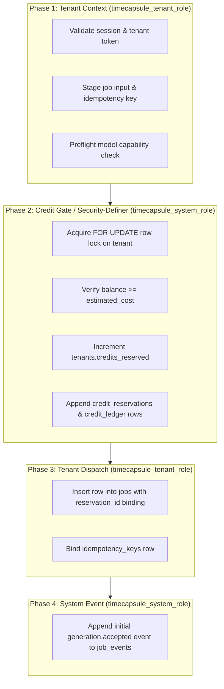

# Architectural Proposal: `createSubmissionTransaction` Elevation Split (Track A3)

## Current Limitation Analysis
In the current implementation of `packages/timecapsule/src/server/store.js`, `createSubmissionTransaction` executes as `timecapsule_system_role` inside a single ACID PostgreSQL transaction.

### Inventory of SQL Statements in `createSubmissionTransaction`:

1. **`INSERT INTO tenants (tenant_id, credits_balance, credits_reserved) VALUES ($1, 0, 0) ON CONFLICT (tenant_id) DO NOTHING`**
   - **Current Rights Required**: Elevated (`INSERT` on `tenants`).
   - **Why Tenant Role Cannot Run This**: `timecapsule_tenant_role` only has `SELECT` on `tenants`. Granting tenant role arbitrary `INSERT` on `tenants` would allow unverified tenant creation.
   - **Assessment**: Truly requires elevated rights, OR must be eliminated in production where tenants are provisioned explicitly ahead of time.

2. **`SELECT ... FROM tenants WHERE tenant_id = $1 FOR UPDATE`**
   - **Current Rights Required**: Tenant-scoped `SELECT ... FOR UPDATE`.
   - **Why Needed**: Row lock on tenant prevents race conditions and balance double-spends during concurrent job submissions.
   - **Assessment**: Can run under tenant context if tenant role is granted `SELECT ... FOR UPDATE` on its own row.

3. **`SELECT ... FROM idempotency_keys ik JOIN jobs j ... WHERE ik.tenant_id = $1 AND ik.idempotency_key = $2`**
   - **Current Rights Required**: Tenant-scoped `SELECT`.
   - **Assessment**: Fully tenant-scoped, already RLS-compliant for `timecapsule_tenant_role`.

4. **`UPDATE tenants SET credits_reserved = $2, updated_at = NOW() WHERE tenant_id = $1`**
   - **Current Rights Required**: Elevated (`UPDATE` on `tenants.credits_reserved`).
   - **Why Tenant Role Cannot Run This**: Allowing tenant role to directly update `credits_reserved` or `credits_balance` would permit malicious tenants to reset their reserved counter or manipulate ledger balances directly.
   - **Assessment**: Must remain system-governed or executed via a security-definer stored procedure.

5. **`INSERT INTO jobs (...) VALUES (...) RETURNING *`**
   - **Current Rights Required**: Tenant-scoped `INSERT`.
   - **Assessment**: Fully tenant-scoped, `timecapsule_tenant_role` already has `INSERT` on `jobs`.

6. **`INSERT INTO credit_reservations (...) VALUES (...)`**
   - **Current Rights Required**: System-governed reservation recording.
   - **Assessment**: Reservation state should be signed or created by the credit ledger authority.

7. **`INSERT INTO credit_ledger (...) VALUES (...)`**
   - **Current Rights Required**: System-governed audit ledger.
   - **Assessment**: Double-entry ledger append must be tamper-proof against arbitrary client manipulation.

8. **`INSERT INTO idempotency_keys (...) VALUES (...)`**
   - **Current Rights Required**: Tenant-scoped `INSERT`.
   - **Assessment**: Fully tenant-scoped, `timecapsule_tenant_role` already has `INSERT` on `idempotency_keys`.

9. **`INSERT INTO job_events (...) VALUES (...)`**
   - **Current Rights Required**: Elevated (`INSERT` on `job_events`).
   - **Why Tenant Role Cannot Run This**: `timecapsule_tenant_role` only possesses `SELECT` on `job_events` to ensure job lifecycle events cannot be forged by end users.

---

## Proposed Phase Split

### Benefits of the Proposed Split:
1. **Least Privilege**: The web application handling tenant HTTP requests never holds global write capabilities; it only requests atomic credit reservations from a dedicated credit service or Postgres security-definer function.
2. **Blast Radius Reduction**: Even if an attacker achieved arbitrary SQL injection inside the tenant submission handler, they could not modify tenant credit balances without invoking the validated credit reservation contract.
