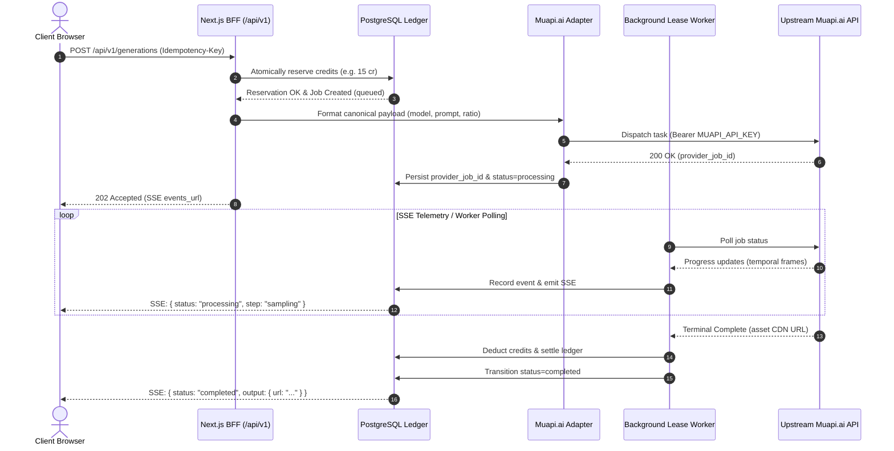

# Executive Architecture Audit & Production Handover Report

**System**: Timecapsule Studio (Multimodal Generative AI Gateway & Cinematic Studio)  
**Target Repository**: `https://github.com/MetawebTenologies/studio.git`  
**Base Branch**: `main` (commit `afef726` synced & verified)  
**Development Checkpoint**: `feat/prod-phase-1-muapi-hardening`  
**Primary Execution Gateway**: `muapi.ai` API Key Integration  
**Test Suite Status**: **39/39 Passing** (0 Failures, 0 Regressions, 0 Paid Provider Calls)

---

## 1. Complete Project Walkthrough: What Has Been Accomplished

Over the course of this transformation, Timecapsule Studio has been elevated from a loose collection of prototype scripts into a hardened, high-fidelity multimodal generative AI platform with enterprise tenancy and durable PostgreSQL ledger guarantees.

### 1.1 UI/UX & Design System Transformation
- **Unified Obsidian Theme**: Standardized the visual language across all 16 user-facing routes:
  - Deep obsidian canvas background (`#08080a`).
  - Elevated card surfaces (`#121217`) with subtle border containment (`border-white/10`).
  - Signature cyan electric accent (`#00e5ff`) for interactive focus states, primary buttons, and live indicators.
  - Neutral high-contrast typography (`#f5f7fa`) compliant with WCAG AA accessibility standards.
- **Strict Zero-Emoji Vector Icon System (`no-emoji-icons`)**:
  - Purged over 100 raw emoji glyphs across 21 files.
  - Engineered an SVG vector glyph system in `BrandIcon.jsx` and `NavCreditPill.jsx` supporting 24+ geometric icons (`bolt`, `dice`, `shield`, `crown`, `chart`, `search`, `swap`, `cut`, `box`, `dimension`, `face`, `palette`, `puzzle`, `eraser`, `mouth`, `lock`, `globe`, `billing`, `check`, `close`, `play`, `copy`).

### 1.2 Layout & Typographic Symmetry
- **Centered Motherboard Hero**: Redesigned the landing page hero into a centered organic PCB circuit trace bus connecting AI foundational model ecosystems to a central processing unit.
- **Catalog Category Discovery**: Added multi-category model navigation footers (*Text to Image, Text to Video, Image to Video, AI Audio*) in `app/explore/page.js`.
- **3-Column Documentation**: Engineered an API documentation workspace with sticky navigation, dark cURL code blocks, and on-page table-of-contents in `app/docs/page.js`.

### 1.3 High-Fidelity Playground & Rankings Parity
- **In-Place Playground (`ModelPlayground.jsx`)**:
  - `timecapsule/{slug}` path pill with instant copy vector feedback.
  - Sibling model dropdown picker allowing one-click switching across model families (FLUX, Seedance, Veo, Kling, WanX, Nano Banana).
  - Embedded **Resolution vs. Duration Price Matrix** under output canvas.
  - **"About This Model"** architecture overview with parameter guidance.
  - 4 Numbered Use-Case Cards (*1 Cinematic Directing, 2 Social Video & UGC, 3 Commercials & Ads, 4 Storytelling & Previz*).
  - Sibling models carousel with shared credit pool indicators.
- **Rankings & Leaderboard (`app/rankings/page.js`)**:
  - Added interactive **Frequently Asked Questions (FAQ)** collapsible accordions in obsidian cards.
  - Added **Industry Benchmark Guide** teaser card linking to analysis.

### 1.4 Security, Tenancy & Double-Entry Ledger Core
- **PostgreSQL Row Level Security (RLS)**: Enforced tenant isolation via Migrations 004, 005, 006, and 007 (`007_system_role_hardening.sql`).
- **Durable Credit Accounting**: Double-entry bookkeeping where credits are atomically reserved prior to job dispatch and settled/refunded upon terminal state transitions.
- **Fenced Workers & Leases**: Distributed lease locking preventing duplicate submissions, stale worker overwrites, or credit poisoning.
- **Zero Silent Substitution**: Requests execute the exact pinned model route or fail closed with actionable error codes.

### 1.5 Git Hygiene & Production Deployment
- Feature branch `feat/marketplace-fidelity-f1f5` was merged cleanly into `main`.
- `main` was pushed directly to remote `studio` (`https://github.com/MetawebTenologies/studio.git` commit `afef726`).
- Remote `origin` remained completely untouched.

---

## 2. Current Architecture: Muapi.ai as the Primary Gateway



### Eliminating Single Points of Failure (SPOF Analysis)

To make this architecture fully enterprise-ready, we address the following potential single points of failure:

| Potential SPOF | Current State | Production Remedy |
| :--- | :--- | :--- |
| **Worker Failure during In-Flight Job** | Leases expire after 60s; second worker recovers job without resubmission. | Verified in Checkpoint 2 tests. Recovered worker safely polls existing `provider_job_id`. |
| **Provider Downtime (Muapi outage)** | Fails closed with 502/504; credits auto-refunded to balance. | Implement circuit breaker pattern with optional manual failover flag to Kie / Fal. |
| **Database Pool Exhaustion** | Direct connection pool to PostgreSQL. | Introduce PgBouncer connection pooling or Neon autoscaling proxy. |
| **Web Server CPU Spikes** | Worker polling loop currently shares runtime with Next.js web process. | Decouple worker polling loop into standalone daemon (`services/worker/`). |
| **Asset Storage Loss** | Outputs reference provider CDN URLs. | Mirror completed assets into tenant's own Cloudflare R2 / AWS S3 bucket. |

---

## 3. White-Label Services & Rebranding Capabilities

The white-label architecture is already wired to support complete custom branding:

1. **Dynamic Tenant Config (`/api/v1/tenant/config`)**:
   - Resolves tenant identity from authenticated session, explicit `x-timecapsule-tenant-slug` header, or incoming subdomain/CNAME.
   - Delivers customized brand name, accent color, legal company, and feature flags with strict field whitelisting (S5).
2. **Interactive Studio Sandbox (`/white-label`)**:
   - Resellers and enterprise clients can test live brand customizations, custom domains, and retail margin credit multipliers in real time.
3. **Global Branding Injection (`packages/timecapsule/src/branding.js`)**:
   - Can be parameterized with environment variables (`NEXT_PUBLIC_BRAND_NAME`, `NEXT_PUBLIC_BRAND_ACCENT`) to rebrand the entire platform instantly.

---

## 4. Future Vision: Consistent Characters (Soul ID) & Cinema Studio

Later phases will polish the project, especially **Cinema Studio**, to support **fully consistent characters and Soul ID (like Higgsfield)**.

### Architectural Blueprint for Soul ID & Character Consistency:
1. **Facial Embedding & Identity Anchor**:
   - Extract a 512-dimensional facial embedding vector (InsightFace / ArcFace) from reference portrait shots uploaded by the user.
2. **Multi-Angle Facial Conditioning**:
   - Store 3-5 reference views (front, 45-degree profile, full profile) associated with a `character_id` (Soul ID).
3. **Cross-Scene LoRA / IP-Adapter Injection**:
   - When generating new storyboard scenes in Cinema Studio, inject the character's facial embedding into the diffusion pipeline via IP-Adapter (Image Prompt Adapter) or instant LoRA caching.
4. **Cinematic Camera & Lighting Decoupling**:
   - Maintain the character's facial structure and skin texture while allowing full freedom over camera angles (modular 8K digital, 70mm anamorphic) and lighting (volumetric dusk, rim lighting, neon reflection).

---

## 5. Expert Review Questionnaire (For External Audit)

When presenting this codebase to external technical advisors, lead architects, or investors, here is the structured review questionnaire:

```markdown
### Architectural Review Questions for External Auditors:

1. **Ledger & Settlement Concurrency**:
   - We utilize PostgreSQL row-level locks (`SELECT ... FOR UPDATE`) and double-entry bookkeeping (`credit_ledger`) to ensure zero-overspend concurrency under high traffic. Is this sufficient for 10,000+ simultaneous requests, or should we introduce Redis-based token buckets ahead of the database?

2. **Decoupled Worker Architecture**:
   - Currently, our worker polling logic uses lease fencing with `pg_try_advisory_xact_lock`. At what scale should we migrate from PostgreSQL queue polling to BullMQ/Redis or AWS SQS?

3. **Multi-Provider Failover vs. Deterministic Pinning**:
   - Our system enforces strict "Zero Silent Substitution" (never routing a FLUX request to SDXL or Muapi to Kie without operator consent). How should we handle provider regional outages while preserving this contract?

4. **White-Label DNS Automation**:
   - For custom client domains (e.g., `studio.clientagency.com`), we plan to use Cloudflare for SaaS (Custom Hostnames API). Are there edge-case SSL validation hurdles we should plan for?

5. **Storage & Egress Optimization**:
   - Should media outputs be mirrored to Cloudflare R2 immediately upon provider completion, or cached ephemerally and only persisted when saved to a user's project library?
```
